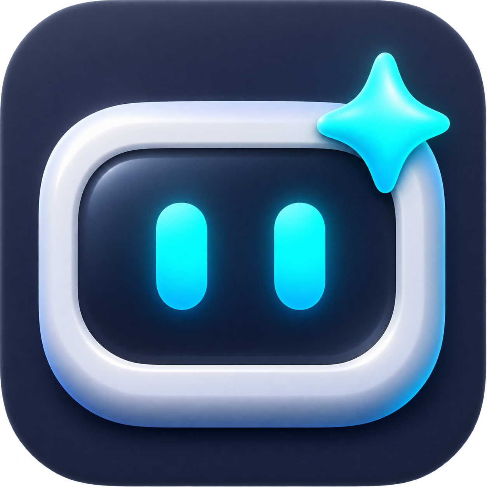
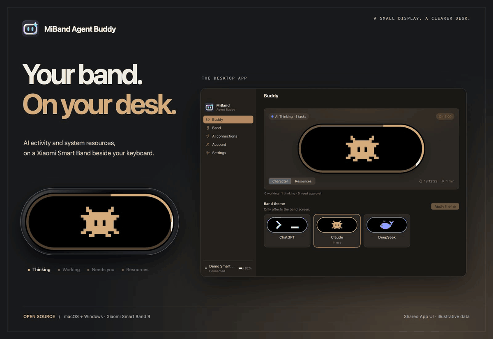

# MiBand Agent Buddy

### A small desktop display for your AI.

Turn Xiaomi Smart Band 9 into a display beside your keyboard: AI task status, animated companions and computer resource usage at a glance. Desktop apps for **macOS and Windows** connect your computer to the band.

**[Download](https://github.com/JamesGZM/miband-agent-buddy/releases/latest)** · [Getting started](#getting-started) · [Documentation](docs/en/README.md) · [Changelog](CHANGELOG.md)

**English** · [简体中文](docs/readme/README.zh-CN.md) · [繁體中文](docs/readme/README.zh-TW.md)

macOS · Windows · Xiaomi Smart Band 9 · AGPL-3.0-only

<picture>
  <source media="(prefers-reduced-motion: reduce)" srcset="docs/images/hero.png">
  
</picture>

Production App UI with illustrative data. Code-drawn band previews are not device photographs.

## At a glance

| Follow your AI | See every task | Keep your computer in view |
| --- | --- | --- |
| Animated ChatGPT, Claude and DeepSeek companions. | A shared multicolor ring keeps independent tasks visible. | CPU, memory and disk usage on a dedicated display beside your keyboard. |

Optional task keep-awake and completion vibration · Band management · Desktop tray controls

Brightness, power saving, keep-awake and per-task vibration are optional. See the [display guide](docs/en/display.md) for controls and notification behavior.

## Download

Download the installer for your computer from [GitHub Releases](https://github.com/JamesGZM/miband-agent-buddy/releases/latest).

| Platform | Architecture | Installer | Portable / in-app updater |
| --- | --- | --- | --- |
| macOS | Apple Silicon | `MiBand-Agent-Buddy-macos-arm64.dmg` | `MiBand-Agent-Buddy-macos-arm64.zip` |
| macOS | Intel x64 | `MiBand-Agent-Buddy-macos-x64.dmg` | `MiBand-Agent-Buddy-macos-x64.zip` |
| Windows | x64 | `MiBand-Agent-Buddy-windows-x64-setup.exe` | — |
| Windows | ARM64 | `MiBand-Agent-Buddy-windows-arm64-setup.exe` | — |

On macOS, open the DMG and drag **MiBand Agent Buddy.app** to **Applications**. On Windows, run the matching NSIS installer. Checksums and corresponding sources accompany every release.

**Windows builds are available as experimental previews. Bluetooth/SPP has not been tested on real Windows hardware;** build success does not establish pairing, band communication or reconnection. In-app updates currently support macOS; Windows users download the next installer. Linux is not supported. macOS packages are not Apple-notarized and Windows installers are unsigned. See the [installation and verification guide](docs/en/open-source/RELEASING.md).

## Getting started

1. Open the app and follow the setup guide. Sign in with the Xiaomi account and service region you use in Mi Fitness.
2. Select your band and follow the pairing prompts. Keep it near your computer and disconnect other apps that are using it during setup.
3. Install Buddy when prompted, then open **Buddy** to choose a theme and view your computer's activity.
4. Optionally open **AI connections** to connect your coding tools. Computer resource monitoring works without an AI connection.

Tap the band screen to switch between Buddy and resource usage. Long-press to exit Buddy. Click the desktop preview to wake it.

In **Settings**, **Keep awake during tasks** is off by default. When enabled, the idle countdown starts after all tasks finish. **Power saving** is also off by default. Manage Buddy installation and updates in **Band**; check app updates using the version control in **Settings → About**.

In **Settings → Task notifications**, **Task completion vibration** is off by default. Enable it for one vibration per completed AI task, including concurrent tasks that finish separately. Choose **Short** (default) or **Long**; the band system controls duration. It requires Buddy with vibration support and a host that sends real completion Hooks; tool completion, cancellation and approval requests do not trigger it. Settings separate appearance, startup/sync, band display, task notifications and about information.

## The desktop app

| Band management | AI connections |
| --- | --- |
|  |  |

More screenshots

| Account | Settings |
| --- | --- |
|  |  |
| **Resource monitoring** | **Display and notifications** |
|  |  |

## Connect your AI tools

Copy the setup request from **AI connections** into your project's AI conversation, or share the [Buddy Hooks skill](https://github.com/JamesGZM/miband-agent-buddy/blob/main/skills/buddy-hooks/SKILL.md). It guides the AI through project configuration and verification.

| Tool | Connection |
| --- | --- |
| Codex | Project Hooks |
| Claude Code | Project Hooks |
| Claude Desktop Code | The Claude Code route for a local project |
| Custom tools, including DeepSeek-based harnesses | Lifecycle callbacks through the local integration interface |

Ordinary ChatGPT and Claude chats do not currently provide automatic task synchronization. Custom integrations need actual task lifecycle events. See the [integration guide](docs/en/development/hooks.md) for setup details and supported events.

## Compatibility

| Device | Status |
| --- | --- |
| Xiaomi Smart Band 9 NFC | Tested; see current limitations below |
| Xiaomi Smart Band 9 | Targeted; physical verification is pending |
| Smart Band 9 Pro / Active and other generations | Not supported |

Bluetooth recovery and long-duration display retention are still being validated across firmware versions. See [testing and known limitations](docs/en/testing.md) for the current verification scope.

## Privacy

AI integrations send task status, not prompts, tool arguments or conversation content. Resource monitoring runs locally. The app has no analytics service. Account data is stored locally; read the [security and privacy policy](SECURITY.md) before sharing diagnostics.

## Contributing

Bug reports, translations, documentation, device testing and code contributions are welcome. Start with [CONTRIBUTING.md](CONTRIBUTING.md), then follow the [development guide](docs/en/development/README.md). For usage help, see [Support](SUPPORT.md).

## License

MiBand Agent Buddy is licensed under [AGPL-3.0-only](LICENSE). Third-party components retain their respective licenses; see [Third-party notices](THIRD_PARTY_NOTICES.md).

This is an independent community project and is not affiliated with Xiaomi, OpenAI, Anthropic or DeepSeek.

## Acknowledgements

- AstralSightStudios and the AstroBox contributors: [Core](https://github.com/AstralSightStudios/AstroBox-NG-Module-Core), [Account](https://github.com/AstralSightStudios/AstroBox-NG-Module-Account), [Bluetooth](https://github.com/AstralSightStudios/AstroBox-NG-Module-Bluetooth) and [Classic SPP](https://github.com/AstralSightStudios/AstroBox-NG-Plugin-BtClassicSpp).
- [Agent Buddy](https://github.com/DanWahlin/agent-buddy) by Dan Wahlin, for the companion concept and inspiration.
- [Tauri](https://tauri.app/) and [Xiaomi Vela](https://iot.mi.com/vela/quickapp/), and the maintainers of the open-source dependencies that make this project possible.
