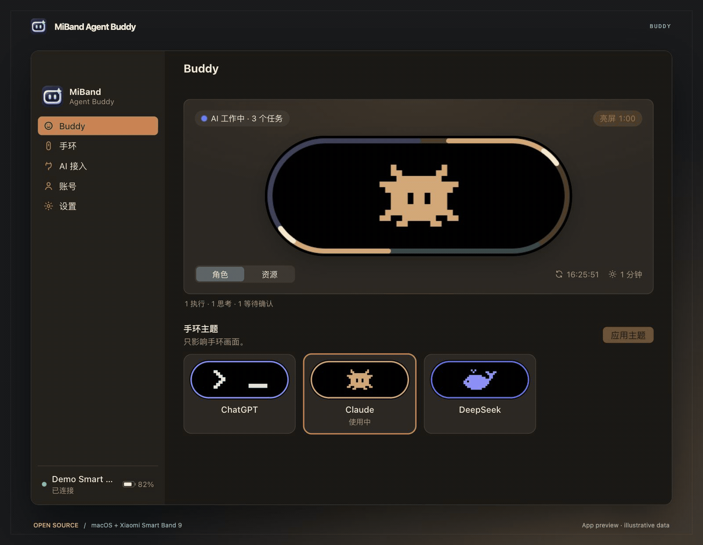
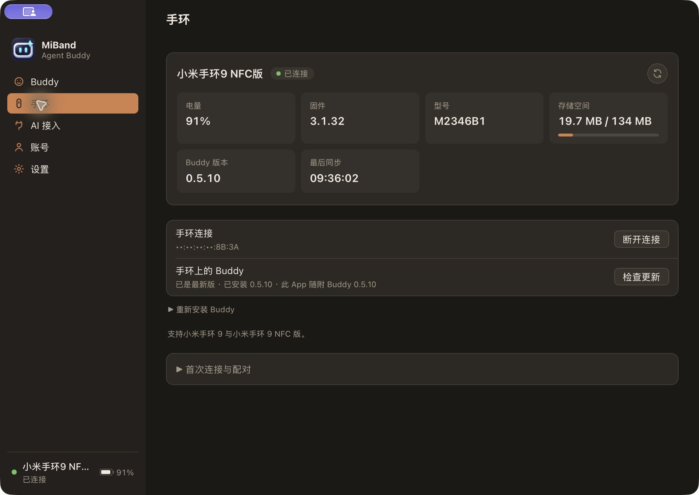
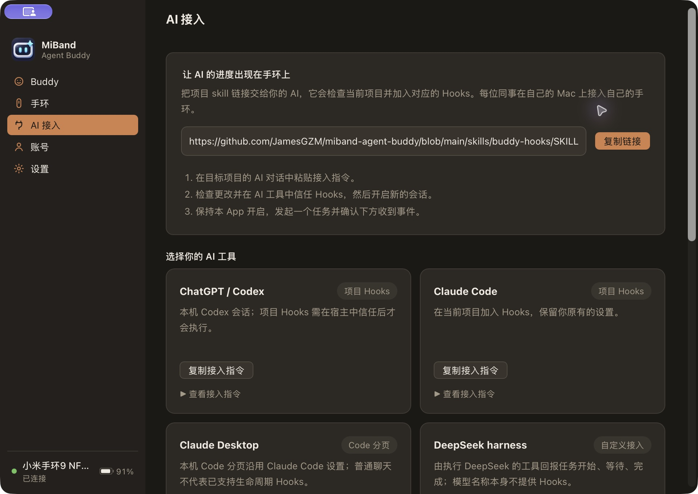
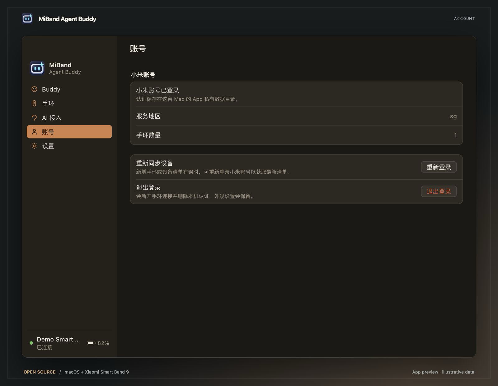
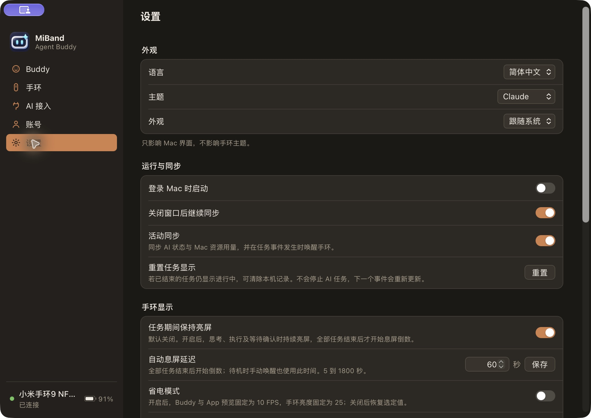
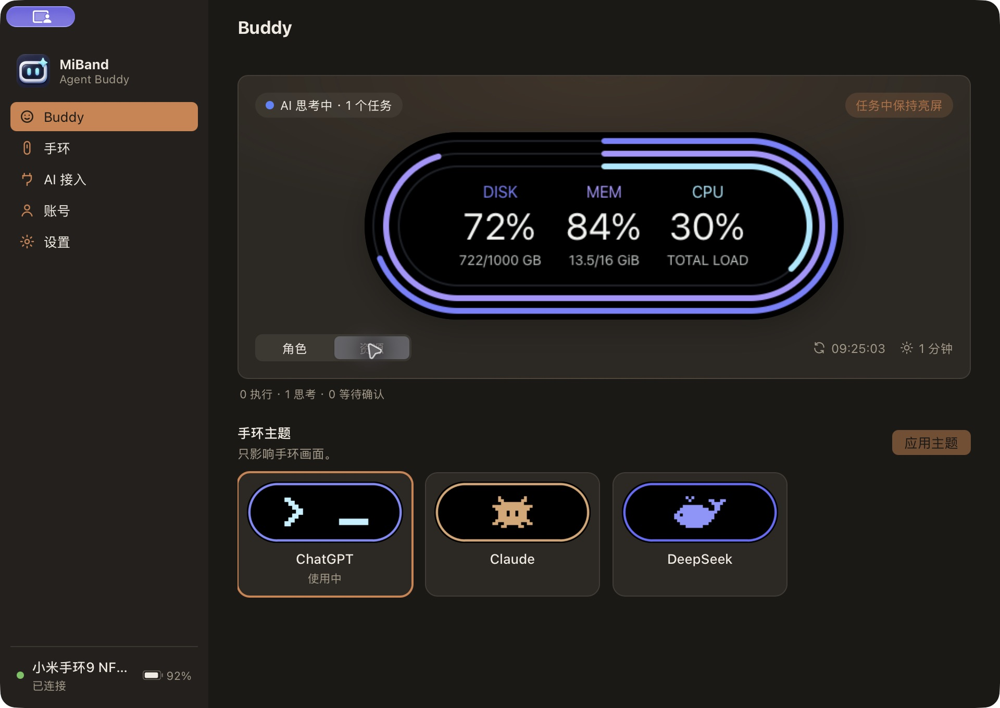
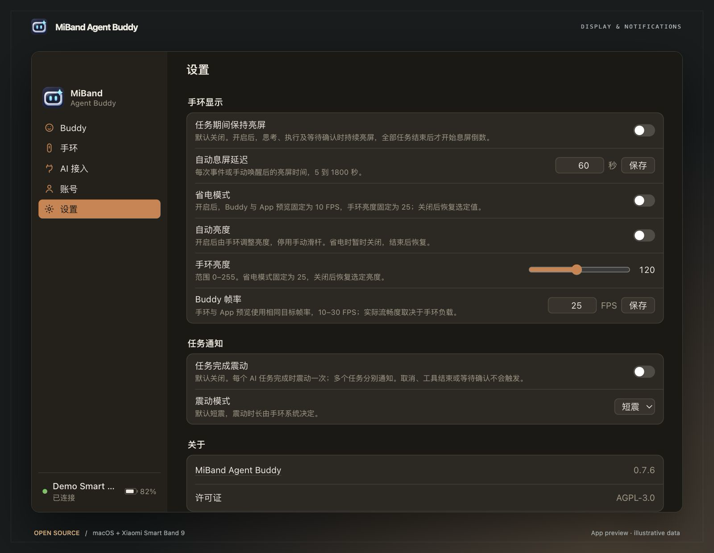

# MiBand Agent Buddy

**English** · [简体中文](README.zh-CN.md) · [繁體中文](README.zh-TW.md)

An open-source macOS companion that brings AI task activity and Mac resource usage to your Xiaomi Smart Band 9.

[Download](https://github.com/JamesGZM/miband-agent-buddy/releases/latest) · [Getting started](#getting-started) · [Contributing](CONTRIBUTING.md) · [Changelog](CHANGELOG.md)

## Features

- Animated Buddy themes for ChatGPT, Claude and DeepSeek, with a live preview on your Mac.
- Task states for thinking, working and waiting for confirmation. Concurrent tasks share a multicolor ring, so one completed task does not hide the others.
- CPU, memory and disk usage at a glance.
- Optional task keep-awake, an adjustable idle screen timeout and a power-saving animation mode.
- Band connection, battery, storage and Buddy installation management in one place.
- Menu-bar controls, optional background operation, app updates, and English, Simplified Chinese and Traditional Chinese interfaces.

## App screenshots

Actual macOS App pages, captured from the local build. The homepage animation is recorded from the live App preview, not a band photograph.

| Band management | AI connections |
| --- | --- |
|  |  |
| **Account** | **Settings** |
|  |  |
| **Resource monitoring** | **Display and task notifications** |
|  |  |

## Download

Download the package for your Mac from [GitHub Releases](https://github.com/JamesGZM/miband-agent-buddy/releases/latest), unzip it, and move **MiBand Agent Buddy.app** to Applications.

| Mac | Package |
| --- | --- |
| Apple Silicon | `MiBand-Agent-Buddy-macos-arm64.zip` |
| Intel | `MiBand-Agent-Buddy-macos-x64.zip` |

Current releases are not Apple-notarized. If macOS blocks the first launch, follow the [installation instructions](docs/open-source/RELEASING.md) after checking the download source.

### Windows preview

Experimental unsigned **x64** and **ARM64** NSIS installers are included in [GitHub Releases](https://github.com/JamesGZM/miband-agent-buddy/releases/latest), with SHA-256 checksums and corresponding sources. Every release requires both Windows and both Mac architectures to build successfully. The [Windows workflow](https://github.com/JamesGZM/miband-agent-buddy/actions/workflows/windows.yml) also remains available for manual diagnostic builds. Windows Bluetooth, account login, installation and notifications still need physical verification. In-app updates are currently Mac-only. Linux is not supported.

## Band brightness and battery status

Use the Band brightness slider in Settings → Band display (0–255). Before a brightness choice is saved, the app preserves the native mode; unavailable readings stay unknown. Power saving uses exactly 25 and 10 FPS; switching it off restores the saved brightness and frame rate. The Mac shows “Charging” beside the battery. Below 20%, it displays an in-app warning and requests a Mac system notification once per low-battery cycle, including while charging. Repeated samples/reconnections do not repeat it; reaching 20% rearms the alert. System notification delivery follows macOS notification settings. Battery/charging changes are forwarded from device-state events, with a roughly 5–6 second polling fallback when the link is available; installation, waking and transport work can delay them.

Automatic brightness has its own App switch and disables the manual slider. Power saving temporarily uses manual mode at 25, then restores the selected mode and manual value. An unverified initial zero is shown as unknown instead of becoming a saved default. Brightness operations check native mode/value readback; success callbacks alone do not establish applied brightness.

## Getting started

1. Open the app and follow the setup guide. Sign in with the Xiaomi account and service region you use in Mi Fitness.
2. Select your band and follow the pairing prompts. Keep it near your Mac and disconnect other apps that are using it during setup.
3. Install Buddy when prompted, then open **Buddy** to choose a theme and view your Mac's activity.
4. Optionally open **AI connections** to connect your coding tools. Mac resource monitoring works without an AI connection.

Tap the band screen to switch between Buddy and resource usage. Long-press to exit Buddy. Click the Mac preview to wake it.

In **Settings**, **Keep awake during tasks** is off by default. When enabled, the idle countdown starts after all tasks finish. **Power saving** is also off by default. Manage Buddy installation and updates in **Band**; check app updates using the version control in **Settings → About**.

In **Settings → Task notifications**, **Task completion vibration** is off by default. Enable it for one vibration per completed AI task, including concurrent tasks that finish separately. Choose **Short** (default) or **Long**; the band system controls duration. It requires Buddy with vibration support and a host that sends real completion Hooks; tool completion, cancellation and approval requests do not trigger it. Settings separate appearance, startup/sync, band display, task notifications and about information.

## Connect your AI tools

Copy the setup request from **AI connections** into your project's AI conversation, or share the [Buddy Hooks skill](https://github.com/JamesGZM/miband-agent-buddy/blob/main/skills/buddy-hooks/SKILL.md). It guides the AI through project configuration and verification.

| Tool | Connection |
| --- | --- |
| Codex | Project Hooks |
| Claude Code | Project Hooks |
| Claude Desktop Code | The Claude Code route for a local project |
| Custom tools, including DeepSeek-based harnesses | Lifecycle callbacks through the local integration interface |

Ordinary ChatGPT and Claude chats do not currently provide automatic task synchronization. Custom integrations need actual task lifecycle events. See the [integration guide](docs/development/hooks.md) for setup details and supported events.

## Compatibility

| Device | Status |
| --- | --- |
| Xiaomi Smart Band 9 NFC | Tested; see current limitations below |
| Xiaomi Smart Band 9 | Targeted; physical verification is pending |
| Smart Band 9 Pro / Active and other generations | Not supported |

Bluetooth recovery and long-duration display retention are still being validated across firmware versions. See [testing and known limitations](docs/testing.md) for the current verification scope.

## Privacy

AI integrations send task status, not prompts, tool arguments or conversation content. Resource monitoring runs locally. The app has no analytics service. Account data is stored locally; read the [security and privacy policy](SECURITY.md) before sharing diagnostics.

## Contributing

Bug reports, translations, documentation, device testing and code contributions are welcome. Start with [CONTRIBUTING.md](CONTRIBUTING.md), then follow the [development guide](docs/development/README.md). For usage help, see [Support](SUPPORT.md).

## License

MiBand Agent Buddy is licensed under [AGPL-3.0-only](LICENSE). Third-party components retain their respective licenses; see [Third-party notices](THIRD_PARTY_NOTICES.md).

This is an independent community project and is not affiliated with Xiaomi, OpenAI, Anthropic or DeepSeek.

## Acknowledgements

- AstralSightStudios and the AstroBox contributors: [Core](https://github.com/AstralSightStudios/AstroBox-NG-Module-Core), [Account](https://github.com/AstralSightStudios/AstroBox-NG-Module-Account), [Bluetooth](https://github.com/AstralSightStudios/AstroBox-NG-Module-Bluetooth) and [Classic SPP](https://github.com/AstralSightStudios/AstroBox-NG-Plugin-BtClassicSpp).
- [Agent Buddy](https://github.com/DanWahlin/agent-buddy) by Dan Wahlin, for the companion concept and inspiration.
- [Tauri](https://tauri.app/) and [Xiaomi Vela](https://iot.mi.com/vela/quickapp/), and the maintainers of the open-source dependencies that make this project possible.
