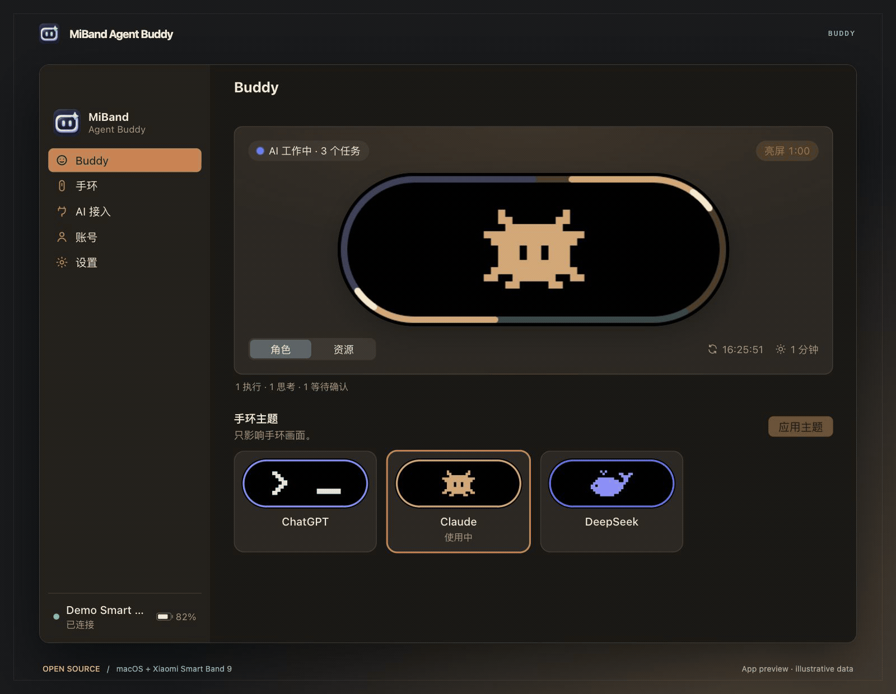
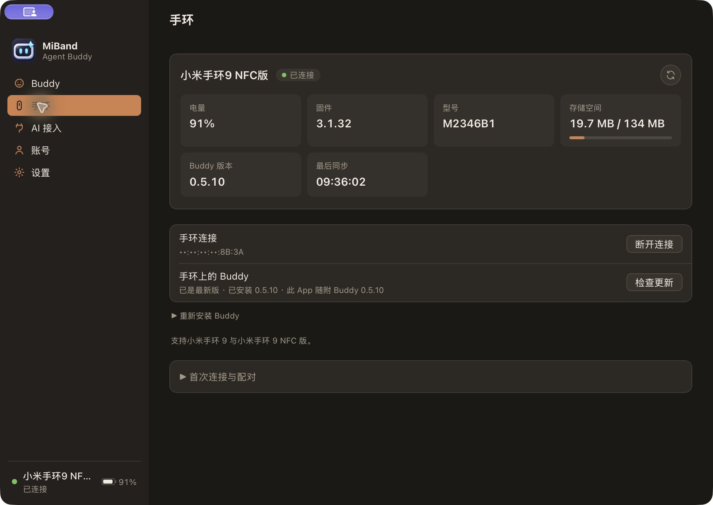
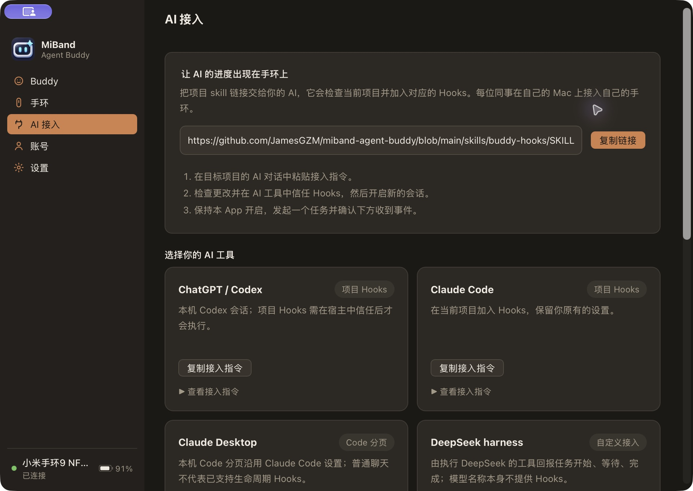
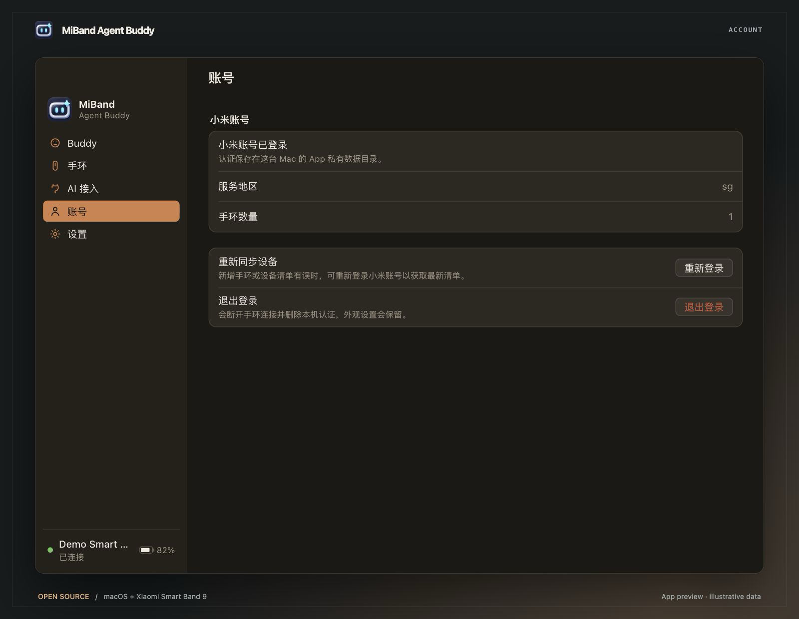
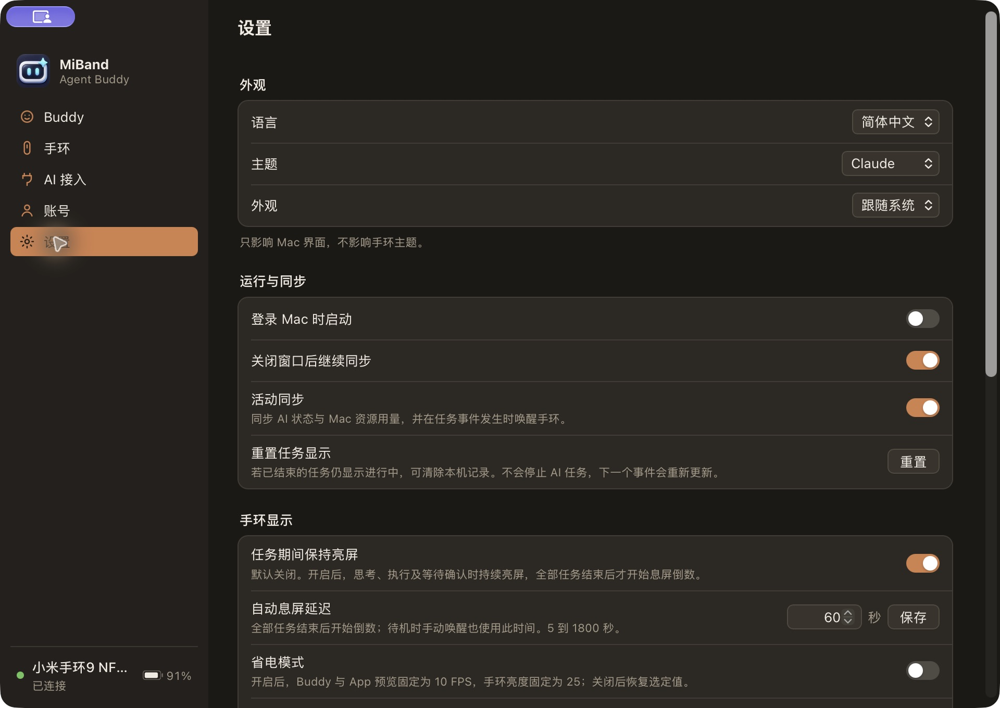
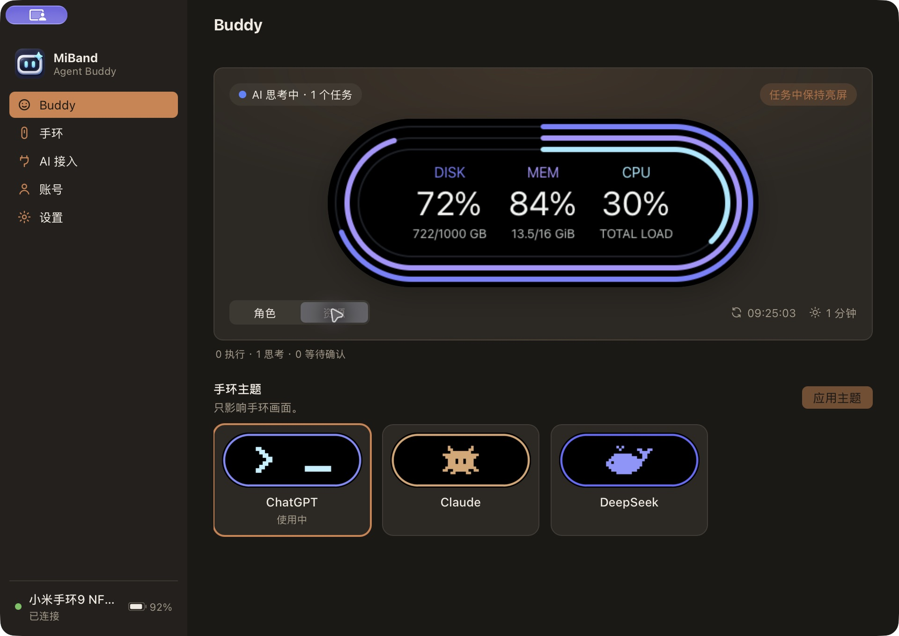
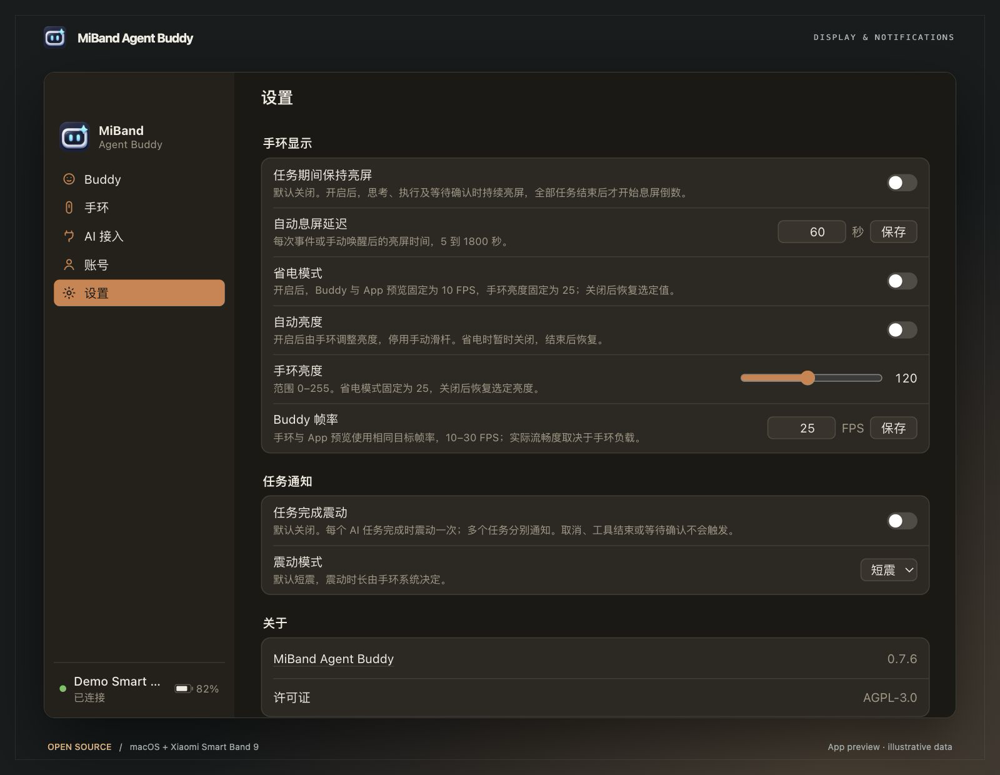

# MiBand Agent Buddy

[English](README.md) · **简体中文** · [繁體中文](README.zh-TW.md)

一款开源 macOS 伴侣应用，让小米手环 9 显示 AI 任务状态和 Mac 资源用量。

[下载](https://github.com/JamesGZM/miband-agent-buddy/releases/latest) · [开始使用](#开始使用) · [参与贡献](CONTRIBUTING.zh-CN.md) · [更新记录](CHANGELOG.zh-CN.md)

## 功能

- ChatGPT、Claude 与 DeepSeek 动态 Buddy 主题，在 Mac 上实时预览。
- 展示思考、执行与等待确认状态；多个任务共用多色圆环，其中一个任务结束不会遮蔽其他任务。
- 查看 CPU、内存和磁盘用量。
- 可选的任务期间保持亮屏、自定义待机息屏时间与省电动画模式。
- 集中管理手环连接、电量、存储空间与 Buddy 安装。
- 菜单栏控制、可选后台运行、App 更新，以及简体中文、繁体中文和英文界面。

## App 截图

以下为本地版本的真实 macOS App 页面。首页 GIF 录制自 App 实时预览，不是手环实拍照片。

| 手环管理 | AI 接入 |
| --- | --- |
|  |  |
| **账号** | **设置** |
|  |  |
| **资源监控** | **显示与任务通知** |
|  |  |

## 下载

从 [GitHub Releases](https://github.com/JamesGZM/miband-agent-buddy/releases/latest) 下载适合你的 Mac 的 DMG，打开后将 **MiBand Agent Buddy.app** 拖到 **Applications（应用程序）** 快捷入口。ZIP 继续提供便携解压和 App 内更新用途。

| Mac | DMG 安装包 | ZIP（便携／更新器） |
| --- | --- | --- |
| Apple Silicon | `MiBand-Agent-Buddy-macos-arm64.dmg` | `MiBand-Agent-Buddy-macos-arm64.zip` |
| Intel | `MiBand-Agent-Buddy-macos-x64.dmg` | `MiBand-Agent-Buddy-macos-x64.zip` |

当前版本尚未经过 Apple 公证。如果 macOS 阻止首次打开，请确认下载来源后按照[安装说明](docs/open-source/RELEASING.zh-CN.md)操作。

### Windows 预览版

**Windows 蓝牙／SPP 尚未在 Windows 真机实测。** Actions 编译、Rust 测试和 NSIS 打包成功不代表配对、手环通信、重连或持续运行已验证。

实验性的无证书 **x64** 和 **ARM64** NSIS 安装包随 [GitHub Releases](https://github.com/JamesGZM/miband-agent-buddy/releases/latest)提供，包含 SHA-256 与对应源码。每次发布要求两种 Windows 与两种 Mac 架构全部构建成功。[Windows 工作流](https://github.com/JamesGZM/miband-agent-buddy/actions/workflows/windows.yml)仍保留手动诊断入口。Windows 蓝牙、账号登录、安装与通知尚待实机验证；App 内更新目前仅支持 Mac。Linux 暂不支持。

## 手环亮度与电量状态

在设置 → 手环显示中使用亮度滑杆，范围 0–255。未保存亮度选择时保留原生模式，无法可靠读取时显示未知。省电模式固定为 25 和 10 FPS，关闭后恢复保存的亮度和帧率。Mac 电量旁会明确显示“充电中”。低于 20% 时在 App 内提示，并请求一次 Mac 系统通知，充电期间同样适用；持续低电量及重新连接不会重复提醒，电量恢复至 20% 后重新触发下一轮提醒。系统通知是否显示由 macOS 通知设置决定。电量和充电变化通过设备状态事件更新，连接可用时约每 5–6 秒查询兜底，安装、唤醒和通信操作可能延迟更新。

App 中可切换自动亮度，开启后禁用手动滑杆。省电时暂时使用手动模式和亮度 25，关闭省电后恢复所选模式及手动值。首次读取的未验证零值显示为未知，不作为保存默认值。亮度操作校验模式和数值读回，成功回调本身不代表实际生效。

## 开始使用

1. 打开 App 并按照设置引导操作，登录与小米运动健康相同的小米账号和服务地区。
2. 选择手环并完成配对提示。设置时请让手环靠近 Mac，并断开其他正在连接手环的 App。
3. 根据提示安装 Buddy，然后打开 **Buddy** 页面选择主题、查看 Mac 的状态。
4. 可选：打开 **AI 接入**，连接你的编程工具。未接入 AI 时也可以查看 Mac 资源用量。

轻点手环屏幕可切换 Buddy 和资源页面，长按可退出 Buddy。点击 Mac 上的预览可以唤醒手环。

**设置**中的**任务期间保持亮屏**默认关闭；开启后，所有任务结束才开始待机息屏倒数。**省电模式**同样默认关闭。Buddy 的安装与更新在**手环**页面管理；App 更新可通过**设置 → 关于**中的版本按钮检查。

**设置 → 任务通知**中的**任务完成震动**默认关闭。开启后，每个 AI 任务完成时震动一次，多个任务分别完成时分别通知；可选**短震**（默认）或**长震**，时长由手环系统控制。需要支持震动的 Buddy 及宿主真实的完成 Hooks；工具结束、取消和等待确认不会触发。设置页按外观、运行与同步、手环显示、任务通知、关于分组。

## 接入 AI 工具

将 **AI 接入**页面的设置请求复制到项目的 AI 对话中，或分享 [Buddy Hooks skill](https://github.com/JamesGZM/miband-agent-buddy/blob/main/skills/buddy-hooks/SKILL.md) 链接，由 AI 按照指引完成项目配置与验证。

| 工具 | 接入方式 |
| --- | --- |
| Codex | 项目 Hooks |
| Claude Code | 项目 Hooks |
| Claude Desktop Code | 本地项目使用 Claude Code 接入方式 |
| 自定义工具，包括使用 DeepSeek 的 harness | 通过本地接入接口发送任务生命周期事件 |

ChatGPT 和 Claude 的普通聊天目前不提供自动任务同步。自定义接入需要真实的任务生命周期事件。配置细节与支持的事件见[接入指南](docs/development/hooks.zh-CN.md)。

## 兼容性

| 设备 | 状态 |
| --- | --- |
| 小米手环 9 NFC 版 | 已实机测试；请参阅下方已知限制 |
| 小米手环 9 标准版 | 目标支持，实机验证尚未完成 |
| 小米手环 9 Pro／Active 及其他代际 | 暂不支持 |

不同固件下的蓝牙恢复与长时间亮屏仍在持续验证。当前验证范围见[测试与已知限制](docs/testing.zh-CN.md)。

## 隐私

AI 接入只发送任务状态，不传输提示词、工具参数或对话内容。资源监测在本机进行，项目不包含分析或遥测服务。账号资料保存在本机；分享诊断前请阅读[安全与隐私说明](SECURITY.zh-CN.md)。

## 参与贡献

欢迎提交问题报告、翻译、文档、设备测试结果和代码。请先阅读[贡献指南](CONTRIBUTING.zh-CN.md)，再按照[开发文档](docs/development/README.zh-CN.md)准备环境。使用问题请参阅[支持指南](SUPPORT.zh-CN.md)。

## 许可证

MiBand Agent Buddy 使用 [AGPL-3.0-only](LICENSE) 许可证。第三方组件保留各自的许可证，详见[第三方声明](THIRD_PARTY_NOTICES.zh-CN.md)。

本项目由社区独立开发，与小米、OpenAI、Anthropic 或 DeepSeek 无隶属关系。

## 致谢

- AstralSightStudios 与 AstroBox 贡献者：[Core](https://github.com/AstralSightStudios/AstroBox-NG-Module-Core)、[Account](https://github.com/AstralSightStudios/AstroBox-NG-Module-Account)、[Bluetooth](https://github.com/AstralSightStudios/AstroBox-NG-Module-Bluetooth) 和 [Classic SPP](https://github.com/AstralSightStudios/AstroBox-NG-Plugin-BtClassicSpp)。
- Dan Wahlin 的 [Agent Buddy](https://github.com/DanWahlin/agent-buddy)，为伴侣角色的交互理念提供了启发。
- [Tauri](https://tauri.app/)、[Xiaomi Vela](https://iot.mi.com/vela/quickapp/)，以及本项目所使用的开源依赖的维护者。
