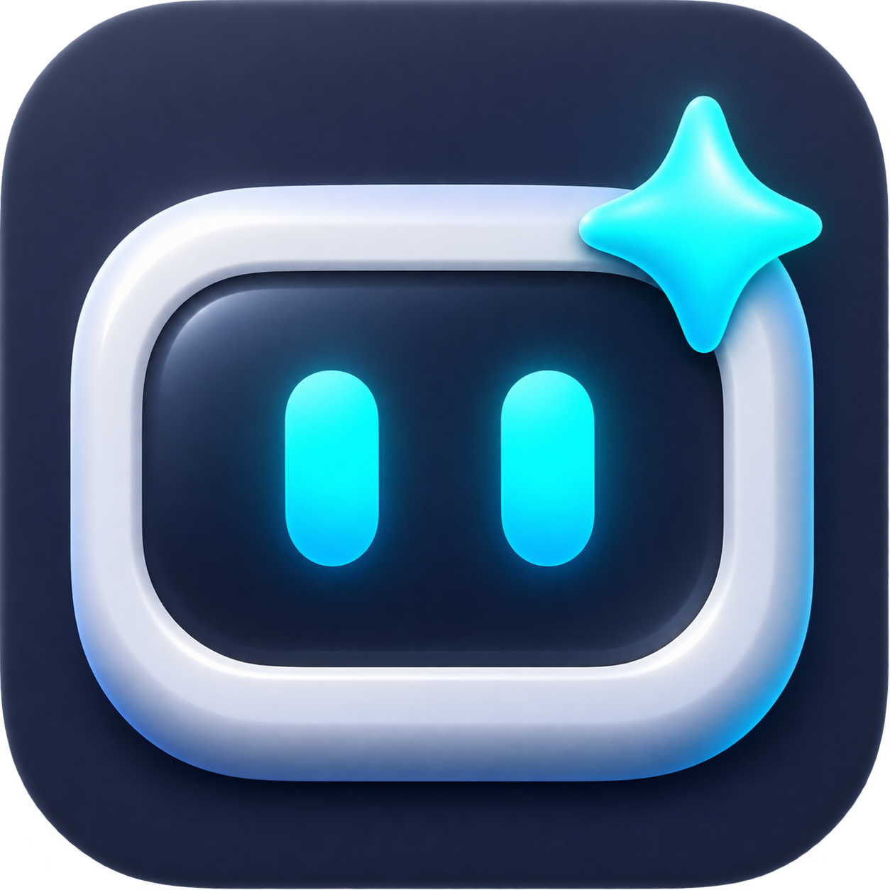
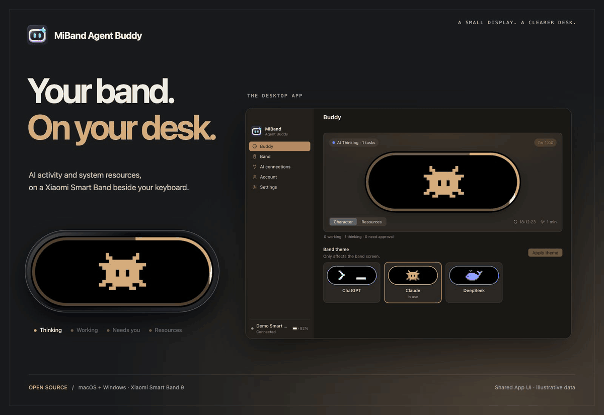
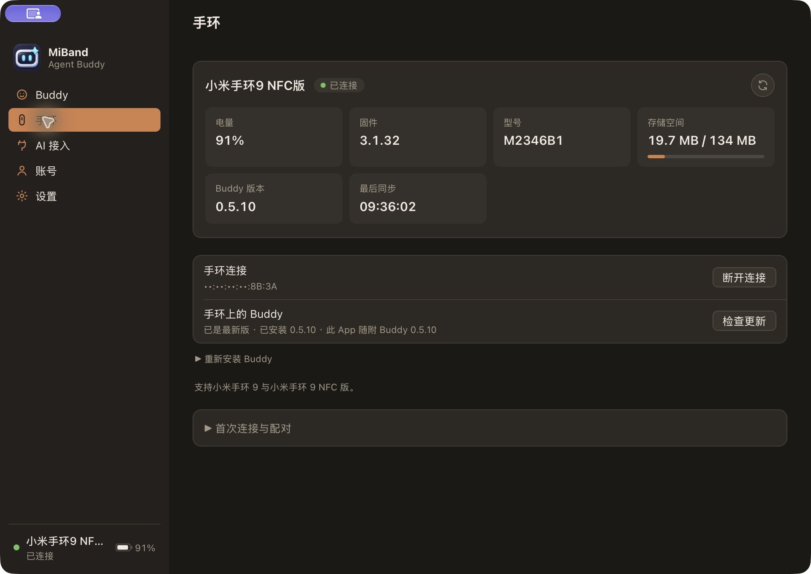
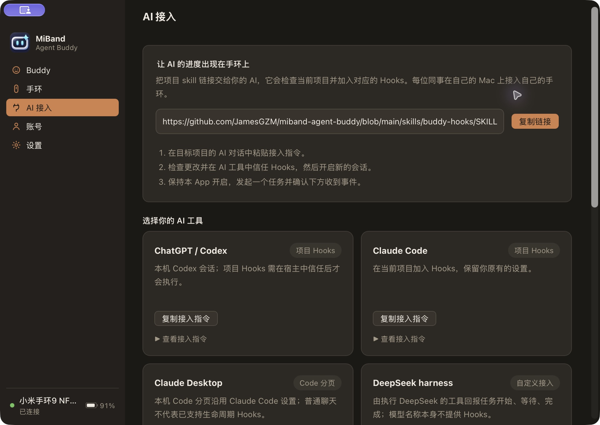
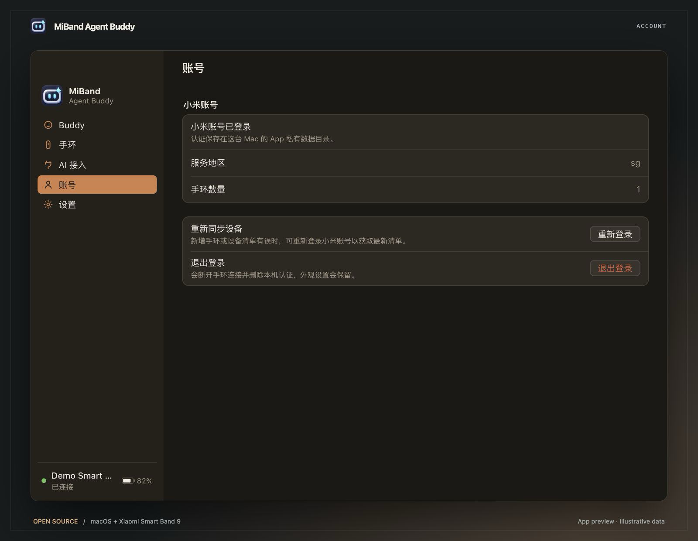
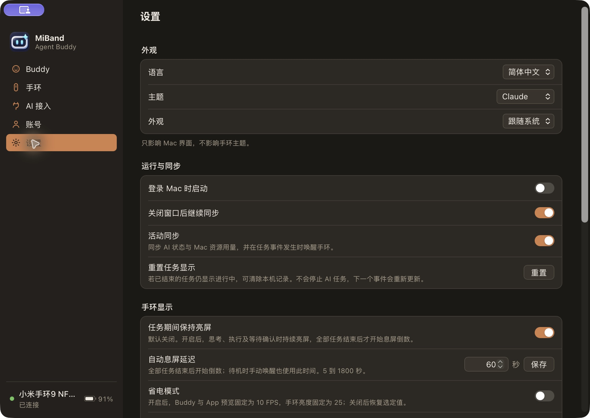
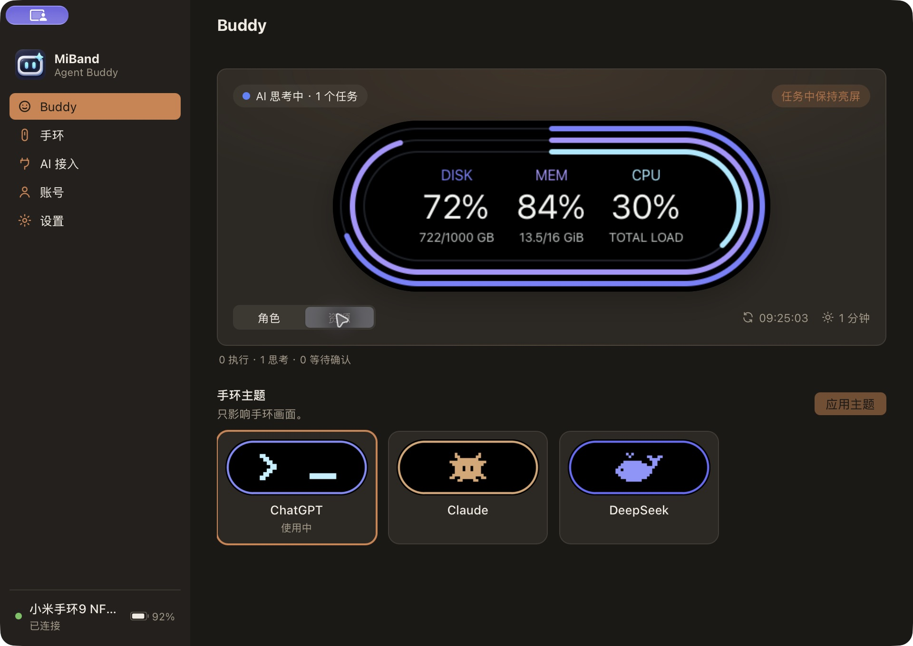
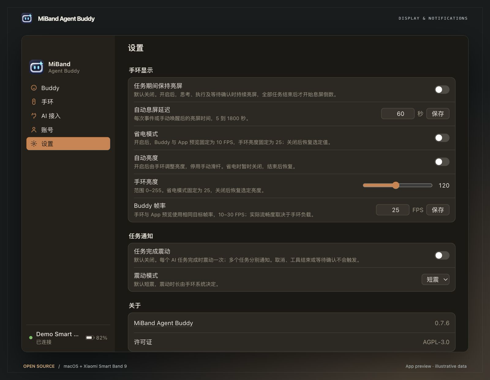

# MiBand Agent Buddy

### 把小米手環，變成桌面的 AI 狀態屏。

把小米手環 9 放在鍵盤旁，隨時查看 AI 任務、動態 Buddy 與電腦資源用量。透過 **macOS 與 Windows 桌面 App** 連接手環，為你的桌面增加一塊小螢幕。

**[下載](https://github.com/JamesGZM/miband-agent-buddy/releases/latest)** · [開始使用](#開始使用) · [文件](../zh-TW/README.md) · [更新紀錄](../zh-TW/CHANGELOG.md)

[English](../../README.md) · [简体中文](README.zh-CN.md) · **繁體中文**

macOS · Windows · Xiaomi Smart Band 9 · AGPL-3.0-only

<picture>
  <source media="(prefers-reduced-motion: reduce)" srcset="../images/hero.png">
  
</picture>

實際 App 前端搭配示例資料；程式繪製的手環預覽並非裝置實拍。

## 桌面多一塊螢幕，進展一眼可見

| AI 有了小夥伴 | 多個任務，一眼看清 | 電腦狀態，就在桌面 |
| --- | --- | --- |
| ChatGPT、Claude、DeepSeek 動態 Buddy 主題。 | 多色圓環呈現獨立任務，一個完成不遮住其他任務。 | 隨時查看 CPU、記憶體和磁碟用量。 |

可選任務亮屏與完成震動 · 手環管理 · 桌面系統匣控制

亮度、省電、任務亮屏和完成震動均可按需設定。控制方式與通知行為見[顯示指南](../zh-TW/display.md)。

## 下載

從 [GitHub Releases](https://github.com/JamesGZM/miband-agent-buddy/releases/latest) 下載適合你電腦的安裝包。

| 平台 | 架構 | 安裝包 | 可攜／App 內更新 |
| --- | --- | --- | --- |
| macOS | Apple Silicon | `MiBand-Agent-Buddy-macos-arm64.dmg` | `MiBand-Agent-Buddy-macos-arm64.zip` |
| macOS | Intel x64 | `MiBand-Agent-Buddy-macos-x64.dmg` | `MiBand-Agent-Buddy-macos-x64.zip` |
| Windows | x64 | `MiBand-Agent-Buddy-windows-x64-setup.exe` | — |
| Windows | ARM64 | `MiBand-Agent-Buddy-windows-arm64-setup.exe` | — |

macOS 開啟 DMG 後，將 **MiBand Agent Buddy.app** 拖入 **Applications**；Windows 執行對應的 NSIS 安裝包。每次發布均提供校驗和與對應原始碼。

**Windows 已提供實驗性預覽版，藍牙／SPP 尚未在 Windows 實機測試。** 建置成功不代表配對、手環通訊或重連已驗證。App 內更新目前支援 macOS，Windows 使用者下載新版安裝包更新。Linux 暫不支援。macOS 包尚未經 Apple 公證，Windows 安裝包無簽名。詳見[安裝與驗證說明](../zh-TW/open-source/RELEASING.md)。

## 開始使用

1. 開啟 App 並按照設定引導操作，登入與小米運動健康相同的小米帳號和服務地區。
2. 選擇手環並完成配對提示。設定時請讓手環靠近電腦，並中斷其他正在連線手環的 App。
3. 根據提示安裝 Buddy，然後開啟 **Buddy** 頁面選擇主題、查看電腦的狀態。
4. 可選：開啟 **AI 接入**，連線你的程式開發工具。尚未接入 AI 時也可以查看 電腦資源用量。

輕點手環螢幕可切換 Buddy 和資源頁面，長按可退出 Buddy。點擊 桌面 App 的預覽可以喚醒手環。

**設定**中的**任務期間保持亮屏**預設關閉；開啟後，所有任務結束才開始待機息屏倒數。**省電模式**同樣預設關閉。Buddy 的安裝與更新在**手環**頁面管理；App 更新可透過**設定 → 關於**中的版本按鈕檢查。

**設定 → 任務通知**中的**任務完成震動**預設關閉。開啟後，每個 AI 任務完成時震動一次，多個任務分別完成時分別通知；可選**短震**（預設）或**長震**，時長由手環系統控制。需要支援震動的 Buddy 及宿主真實的完成 Hooks；工具結束、取消和等待確認不會觸發。設定頁按外觀、執行與同步、手環顯示、任務通知、關於分組。

## 桌面控制中心

| 手環管理 | AI 接入 |
| --- | --- |
|  |  |

更多截圖

| 帳號 | 設定 |
| --- | --- |
|  |  |
| **資源監控** | **顯示與任務通知** |
|  |  |

## 接入 AI 工具

將 **AI 接入**頁面的設定請求複製到專案的 AI 對話中，或分享 [Buddy Hooks skill](https://github.com/JamesGZM/miband-agent-buddy/blob/main/skills/buddy-hooks/SKILL.md) 連結，由 AI 按照指引完成專案設定與驗證。

| 工具 | 接入方式 |
| --- | --- |
| Codex | 專案 Hooks |
| Claude Code | 專案 Hooks |
| Claude Desktop Code | 本地專案使用 Claude Code 接入方式 |
| 自訂工具，包括使用 DeepSeek 的 harness | 透過本地接入介面傳送任務生命週期事件 |

ChatGPT 和 Claude 的一般聊天目前不提供自動任務同步。自訂接入需要實際的任務生命週期事件。設定細節與支援的事件見[接入指南](../zh-TW/development/hooks.md)。

## 相容性

| 裝置 | 狀態 |
| --- | --- |
| 小米手環 9 NFC 版 | 已實機測試；請參閱下方已知限制 |
| 小米手環 9 標準版 | 目標支援，實機驗證尚未完成 |
| 小米手環 9 Pro／Active 及其他代際 | 暫不支援 |

不同韌體下的藍牙恢復與長時間亮屏仍在持續驗證。目前驗證範圍見[測試與已知限制](../zh-TW/testing.md)。

## 隱私

AI 接入只傳送任務狀態，不傳輸提示詞、工具參數或對話內容。資源監測在本機進行，專案不包含分析或遙測服務。帳號資料儲存在本機；分享診斷前請閱讀[安全與隱私說明](../zh-TW/SECURITY.md)。

## 參與貢獻

歡迎提交問題回報、翻譯、文件、裝置測試結果和程式碼。請先閱讀[貢獻指南](../zh-TW/CONTRIBUTING.md)，再按照[開發文件](../zh-TW/development/README.md)準備環境。使用問題請參閱[支援指南](../zh-TW/SUPPORT.md)。

## 授權條款

MiBand Agent Buddy 使用 [AGPL-3.0-only](../../LICENSE) 授權條款。第三方元件保留各自的授權，詳見[第三方聲明](../zh-TW/THIRD_PARTY_NOTICES.md)。

本專案由社群獨立開發，與小米、OpenAI、Anthropic 或 DeepSeek 無隸屬關係。

## 致謝

- AstralSightStudios 與 AstroBox 貢獻者：[Core](https://github.com/AstralSightStudios/AstroBox-NG-Module-Core)、[Account](https://github.com/AstralSightStudios/AstroBox-NG-Module-Account)、[Bluetooth](https://github.com/AstralSightStudios/AstroBox-NG-Module-Bluetooth) 和 [Classic SPP](https://github.com/AstralSightStudios/AstroBox-NG-Plugin-BtClassicSpp)。
- Dan Wahlin 的 [Agent Buddy](https://github.com/DanWahlin/agent-buddy)，為伴侶角色的互動理念提供了啟發。
- [Tauri](https://tauri.app/)、[Xiaomi Vela](https://iot.mi.com/vela/quickapp/)，以及本專案所使用的開源依賴的維護者。
